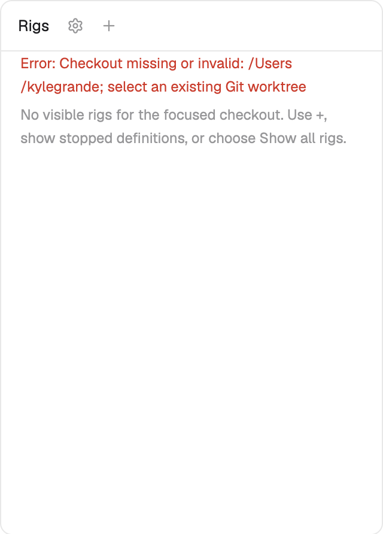

# Herdr Rigs

A native panel of named development stacks, showing services, status, endpoints
and observed apps. Create a stopped definition, inspect its commands and data
scope, then explicitly launch the reviewed stack.

Preview: cropped native workspace capture from 2026-11-13. It deliberately shows
the missing-checkout/empty state, not a running stack or a fresh lifecycle test.

## What you see

A theme-colored sidebar with a 42px Rigs title row, options and +. Expandable
rigs contain compact service rows and connected-peer links. Gray descriptions
show service/checkout counts, repo/worktree, branch and app directory; tooltips
show full details. Static green dots indicate running, warm dots transitions or
attention, and gray rings stopped/draft states. Agent working/blocked/done/idle
is a separate Herdr concern and does not start or stop a rig.

## How it behaves

+ offers Agent Setup Prompt, saved profiles and Import profile. Copying a prompt
does not launch an agent. Creation selects a profile, rig name and concrete
worktrees, then saves and previews. Click a rig name for its preview; use its
chevron to collapse services and links. Hover rig/service rows for Start, Stop
and Restart. Click a service header to peek at output; running HTTP endpoint
icons open their URL. Metrics/TCP details remain in Preview. Options choose
focused/all rigs, stopped visibility and paused polling. Focus filters the view
without changing saved mappings or processes.

Preview exposes commands, ports, connections, data scope and review decisions.
Approve and start launches that configuration. Sidebar Start/Restart explicitly
approve and launch the saved configuration, requiring necessary decisions.
Right-click rigs/profiles for editing/deletion; dialogs explain deletion scope.
Configuration changes invalidate prior approval. Observed apps show read-only
process status and details with no lifecycle controls. Embedded workspace
headers share host drag/hover controls and title double-click rename.

## Built from

Use Node 22.18+, npm, Git, `hc` 0.1.19+ and Herdr 0.1.14+ as specified by this
project. `src/` holds profile resolution, registry, lifecycle, observation and
the versioned CLI; `bin/rig` invokes it. `mods/rigs/main.ts` builds the GPUI
panel. `setup.ts` builds the setup prompt. The mod manifest has `place: "none"`
and `workspace_header: true`. The build generates `main.js`, `setup.js` and
`mods/rigs/AGENTS.md` from sources. Keep root `AGENTS.md` as the editable guide.

The installer makes a personal layout clone and writes the mod plus generated
guide with exact Node/compiled-CLI paths. `cli`, `cliArgs`, `guide` and `nodeId`
props configure execution/help/visibility; internal `view` roles include
`preview`, `new-menu`, `create`, `edit`, `rig-menu`, `profile-menu`, `delete` and
`profile-editor`. Use GPUI controls and host `exec`, `focused`, `spaces`,
`layout`, `props`, `theme`, overlays, `run`, and optional `panel`.
CLI work is asynchronous. Panel data polls every five seconds, respecting
paused/known-hidden layout state. Title rename calls `workspace.rename`;
service output uses `terminal.peek`.

## Watch out

Keep the source checkout and compiled CLI at their installed paths; copying
`mods/rigs` alone does not configure a portable CLI dependency. Registry state
belongs under `RIG_HOME` (default `~/.local/state/herdr-rigs`), never in mod code.
The mod runs its CLI/Git, reads selected profiles/checkouts and opens HTTP URLs.
Explicit stack launches execute profile argv/environment and probe network
endpoints; observations may query an existing remote Windows Core connection.
Profiles and runtime state are not artwork or distributable example data.

Only stop a managed terminal after matching both recorded address and ownership
labels. Never adopt/stop processes by name or port. Unknown ownership retains
reservations. Observed apps remain external and never get stopped by Rigs.
Panel closure/app quit does not stop services. Remote checkouts are not resolved
through the local registry. Process observation is not app readiness or emulator
boot detection. Preserve legacy manual profiles and recorded state.

Use optional namespace access for `panel()` on released hosts; embedded headers
reserve 106px on the right. Refresh installed code through guarded `sync:mod`,
not an installer that rewrites/selects layouts. Do not assume a generated guide
or build result proves desktop/lifecycle acceptance.

## Done when

1. `npm test`, `npm run build:mod` and `npm run check:mod` pass. Check native
   deferred states with `npm run check:mod:states` when changing the panel.
2. Use disposable fixtures for `npm run test:live` / `npm run test:crash` when
   lifecycle behavior changes; stop only fixture launches created by the test.
3. In the intended test app, inspect status and a screenshot; exercise menus,
   preview/review, focused filtering and service output using disposable data.
4. Follow `docs/DESKTOP_ACCEPTANCE.md` for explicit desktop/lifecycle acceptance.
   Verify close/reopen retains definitions and does not stop services. Do not
   restart the user's app or launch/stop their services just to make a preview.
