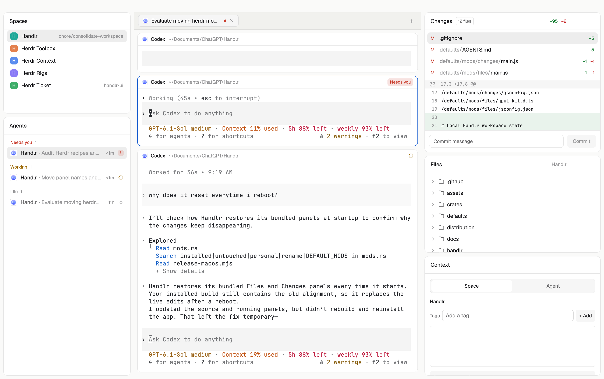

# Handlr panel workspace

A native terminal workspace with persistent, rearrangeable panels around the
terminal center. Spaces and Agents navigate work; Files and Changes inspect the
selected repository. Optional Context, Toolbox and Rigs panels add notes,
command shortcuts and development stacks.

The screenshot is the running Handlr window captured on 2026-11-14. It shows a
personal arrangement, with Context on the right; Toolbox and Rigs are hidden.
It illustrates the native workspace, not the older fixed-layout prototype or
the initial arrangement below. Terminal contents are incidental.

## What you see

The generated initial composition has 320px left and right docks (resizable).
The upper left group has Code and Context views: Code contains Changes and Files
with 1:2 section weights. The lower left group switches between Spaces and
Agents. The right dock contains Toolbox above Rigs with equal group weights.
The center uses the shipped terminal tab bar (42px), pane header (30px),
8px spacing, 10px pane radius and terminal padding inherited from `main`.
Colors use the host theme's canvas, background, border, foreground and accent.
The Settings SVG is a schematic of the initial composition, not a screenshot.

## How it behaves

Terminal tabs select work in the active Space. Spaces and Agents use their
shipped navigation behavior. Agent working, blocked, done and idle states use
the shipped mods' theme colors and urgency; do not invent a separate status store.
The native host supports dragging sections/views/groups, independent resizing,
renaming, floating/redocking, close/reopen placement, and session undo/redo.
Hover a header for controls and double-click its title to rename it. Closing
a panel retains its data. Cmd+Shift+P opens installed panels; Cmd+P reveals
placed panels. Cmd+Option+F floats, adding Shift redocks; Cmd+Option+Z undoes,
adding Shift redoes. These shortcuts describe macOS defaults in this fork.

## Built from

Run `npm run build` from `handlr/`. `scripts/build.mjs` produces:

- `layouts/panel-workspace-native.json`: root column with `workspace` set to
  `panel-workspace-native`, a `tabs` block and the active-tab body using `pane`.
- `workspaces/panel-workspace-native.json`: version 1 panel/group/view/zone
  document, including four outer zones and `top_center`/`bottom_center` docks.
- `layouts/panel-workspace-prototype.json`: the earlier row/column/stack demo.
  This uses `mods/workspace-prototype/main.js`, `actions.js` and `mod.json`;
  props `role: "tabs"` draw simple tabs; `role: "section"`, `section`, `body`
  and `title` identify a collapsible header. It calls `tab.select`, `tab.new`,
  `layout.hide`, `layout.show` and `layout.resize`. It is not the native engine.

Keep both layout SVGs alongside their JSON files. The native layout does not
need the prototype controls mod. Files, Changes, Spaces, Agents, tabs and pane
are bundled host mods. Context, Toolbox and Rigs are separate repositories;
build and configure those using their own recipes/installers before using the
full document. Their sources live in the sibling `Herdr Context`, `Herdr Toolbox`
and `Herdr Rigs` repositories on `fix/workspace-shared-headers`; the temporary
`handlr/mod-worktrees/` checkouts have been removed.
Their code and dependencies are not distributed by this folder.

The portable macOS packager reads this native layout/document, renames the
workspace to Handlr, and filters out external panels. It seeds missing files
only; it does not migrate an existing personal composition. See
`../scripts/package-macos.mjs`. The layout preview is copied with the seed.

## Watch out

This native workspace requires the Handlr host implementation and its
`workspace.*` commands; stock released Herdr must not be assumed compatible.
Read the installed guide/declarations for the exact runtime. Copy a new layout
and its matching workspace document into a scratch app home to try them; never
overwrite personal layouts, workspace documents or shipped files. Keep the
workspace name on the layout root equal to the workspace document basename.
The initial document refers to external mods and is not a self-contained
gallery bundle. Do not copy machine-specific settings, sockets, shared state,
drafts, CLI paths or installed bookkeeping from a developer's home.

Mods can execute programs and read repository files: Files/Changes inspect the
repository, Context uses its local CLI/Core, Toolbox runs explicitly selected
commands, and Rigs manages explicitly launched services and probes endpoints.
Their recipes describe these dependencies. Terminal-to-dock transfers and
binding-based context delivery are not implemented. Binding metadata alone
does not pin a mod's data. The legacy collapse demo has no native docking or
workspace transactions. Existing terminals remain owned by Core.

## Done when

1. `npm run build` produces both layouts and the native document; every preview,
   local import and required mod is present or explicitly installed separately.
2. `npm test` passes; `npm run check:mod` passes for the legacy controls.
3. Each external panel passes its recipe's native check before installing it.
4. In an isolated app home and Core session, the native layout opens without
   file/mod errors; tabs, panel navigation, resize, drag, close/reopen,
   float/redock and undo/redo work. Capture `herdr-app shot` and inspect it.
5. Restart only that test app and verify composition and data survive. Never
   stop another app/Core or launch/stop a user's services for these checks.
